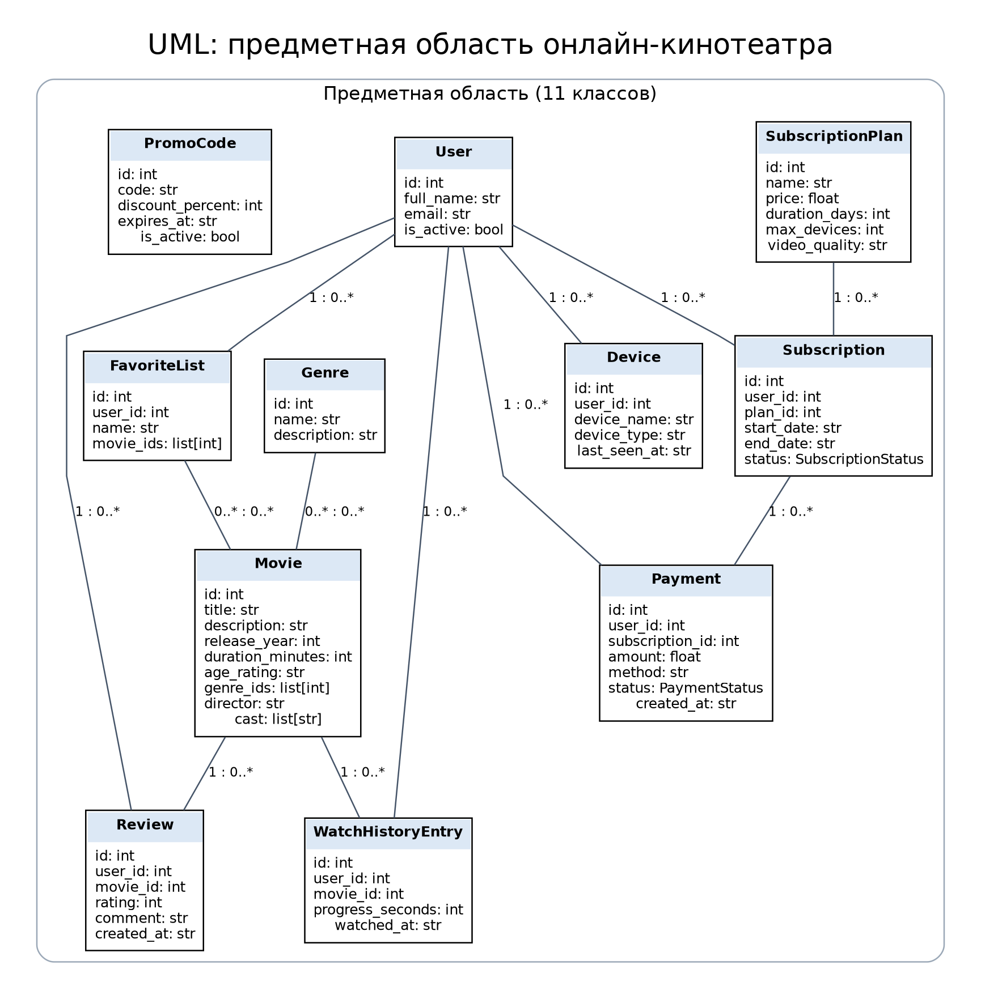
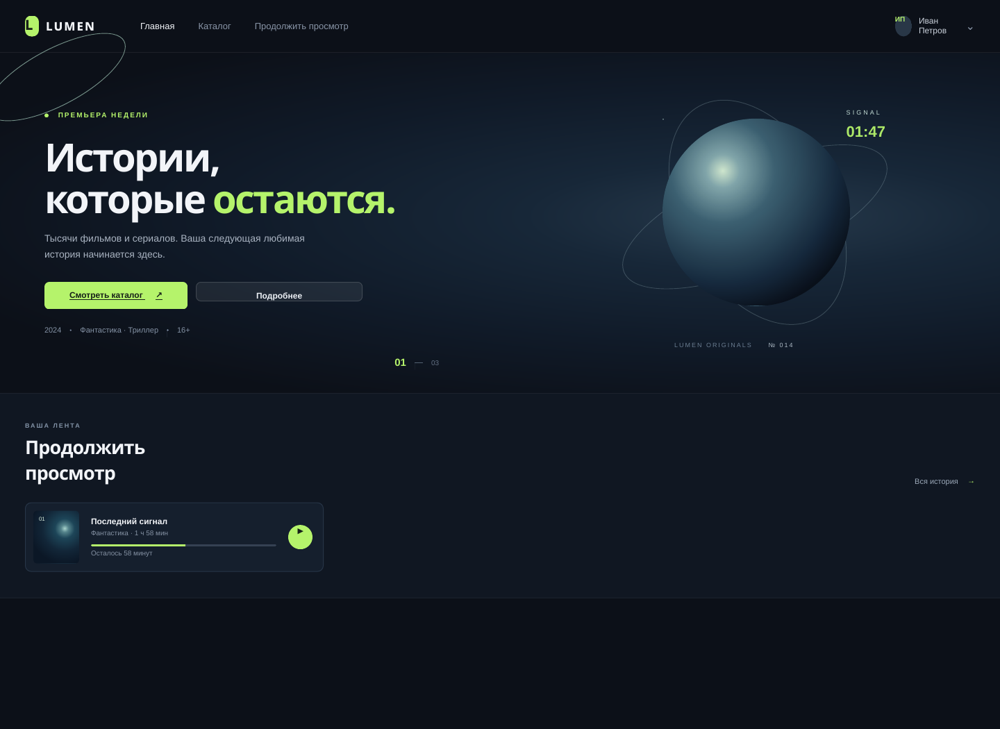
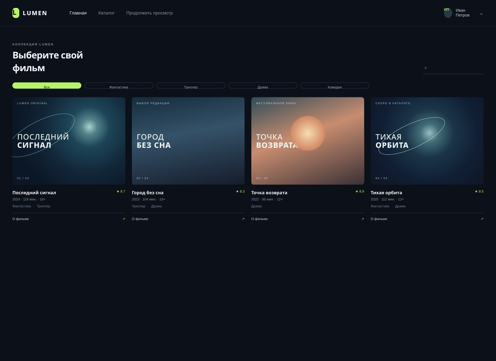

# Лабораторная работа № 1. Онлайн-кинотеатр LUMEN

**Студент:** Богданов Даниил Алексеевич  
**Группа:** ИДБ-25-12  
**Дисциплина:** Прикладное программирование  
**Вариант:** 4  
**Репозиторий:** <https://github.com/palesiemens/lr1-online-cinema>  
**Тема:** ООП в Python. Обработка исключительных ситуаций. Форматы XML и JSON.

## О проекте

LUMEN — учебная программа, моделирующая основные объекты онлайн-кинотеатра. В проекте описаны пользователи, фильмы, жанры, тарифы, подписки, отзывы, история просмотров, избранное, платежи, промокоды и устройства.

Данные хранятся в памяти во время работы программы. Полный набор объектов можно сохранить в JSON или XML, а затем загрузить обратно. Консольное меню показывает основные операции на примере каталога фильмов.

## Возможности

- 11 классов предметной области.
- Создание, чтение, изменение и удаление объектов через `CinemaService`.
- Проверка полей, уникальности значений и связей между объектами.
- Поиск фильмов по названию, описанию и режиссёру.
- Собственные исключения и обработка ожидаемых ошибок.
- Сохранение и загрузка данных в форматах JSON и XML.
- Консольное меню для работы с каталогом фильмов.
- Статический HTML/CSS/JavaScript-прототип интерфейса.

## Структура проекта

```text
lr1-online-cinema/
├── data/
│   ├── online_cinema.json       # пример данных в JSON
│   └── online_cinema.xml        # тот же набор данных в XML
├── diagrams/
│   ├── class_diagram.puml       # исходник UML в PlantUML
│   ├── class_diagram.dot        # исходник UML в Graphviz
│   └── class_diagram.png        # изображение диаграммы
├── docs/
│   ├── ЛР1_Отчет_Вариант_4.docx # редактируемый отчёт
│   └── ЛР1_Отчет_Вариант_4.pdf  # отчёт для просмотра и сдачи
├── online_cinema/
│   ├── __init__.py              # пакет приложения
│   ├── __main__.py              # запуск через python -m online_cinema
│   ├── cli.py                   # консольное меню
│   ├── exceptions.py            # собственные исключения
│   ├── models.py                # классы предметной области
│   ├── repository.py            # хранение объектов и базовые CRUD-операции
│   ├── sample_data.py           # демонстрационные данные
│   ├── service.py               # бизнес-правила и связи объектов
│   └── storage.py               # чтение и запись JSON/XML
├── prototypes/
│   ├── index.html               # HTML-разметка прототипа
│   ├── styles.css               # оформление
│   ├── app.js                   # поиск и фильтрация
│   ├── preview_home.png         # главная страница
│   └── preview_catalog.png      # каталог фильмов
├── .gitignore
└── README.md
```

## Используемые технологии

- Python 3.10 или новее.
- Стандартная библиотека Python: `dataclasses`, `datetime`, `enum`, `json`, `xml.etree.ElementTree`, `pathlib`, `typing` и другие встроенные модули.
- HTML, CSS и JavaScript для статического прототипа.
- Git для контроля версий.

Программа использует только стандартную библиотеку Python. Устанавливать дополнительные пакеты и создавать виртуальное окружение не требуется.

## Запуск в Windows

1. Установите Python версии 3.10 или новее с официального сайта: <https://www.python.org/downloads/windows/>.
2. Распакуйте проект.
3. Откройте PowerShell в корневой папке проекта, рядом с `README.md` и папкой `online_cinema`.
4. Проверьте Python:

```powershell
py --version
```

5. Запустите приложение:

```powershell
py -m online_cinema
```

Если команда `py` не найдена, попробуйте:

```powershell
python -m online_cinema
```

Для выхода из программы выберите пункт `0`.

## Работа с программой

После запуска появляется меню. Пользователь может просмотреть каталог, найти фильм, добавить фильм, изменить его описание, удалить фильм, а также сохранить или загрузить данные в JSON и XML.

Файлы данных находятся в папке `data`. После сохранения программа обновляет соответствующий файл.

## UML-диаграмма

Исходник диаграммы находится в `diagrams/class_diagram.puml`, альтернативный исходник — в `diagrams/class_diagram.dot`, изображение — в `diagrams/class_diagram.png`.



## Прототип интерфейса

Чтобы открыть макет, запустите в браузере `prototypes/index.html`. В нём представлены главная страница онлайн-кинотеатра и каталог фильмов. Поиск и фильтрация демонстрационные; прототип не подключён к Python-приложению и не воспроизводит реальное видео.





## Основные модули

- `models.py` — описание объектов онлайн-кинотеатра и проверка их полей.
- `exceptions.py` — собственные исключения приложения.
- `repository.py` — хранение объектов в словарях и базовые операции CRUD.
- `service.py` — правила работы с объектами и проверка связей.
- `storage.py` — сериализация и десериализация JSON/XML.
- `sample_data.py` — создание демонстрационного набора данных.
- `cli.py` — консольный интерфейс.
- `__main__.py` — точка запуска приложения.

## Ограничения учебной модели

Программа не подключается к реальному видеохостингу, платёжному сервису или серверной базе данных. Фильмы, пользователи, платежи и подписки представлены объектами Python. Во время работы данные хранятся в памяти, а для сохранения используются файлы JSON и XML. HTML-прототип не подключён к Python-приложению.
